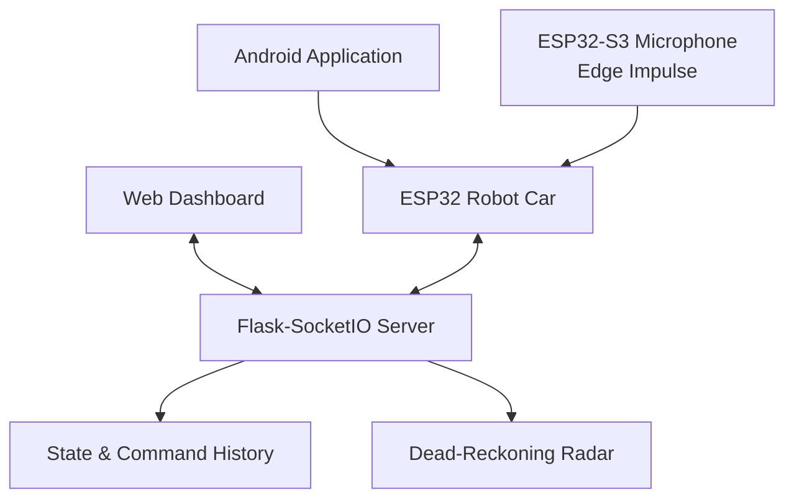

# Voice and Web-Controlled Robot Car Server

[](https://www.python.org/)
[](https://flask.palletsprojects.com/)
[](https://socket.io/)
[](https://www.espressif.com/en/products/socs/esp32)
[](https://www.edgeimpulse.com/)
[](#project-status)

A real-time control server and browser dashboard for an ESP32-based robot car.

The system uses **Flask-SocketIO** as a communication hub between the robot car, web browser, Android application, and an ESP32-S3 voice-recognition device. It forwards movement commands to the car, synchronizes device status, records recent commands and microphone detections, and visualizes the estimated vehicle position using dead reckoning.

> The repository is named `CAR_ROBOT_CONTROL_VOICE_WED`, but the implemented interface is a **web** dashboard. The repository name has been preserved unchanged.

## Features

- Real-time robot control through Socket.IO
- Browser-based control dashboard
- Forward and reverse movement
- Left and right steering
- In-place clockwise and counter-clockwise rotation
- Emergency stop command
- Adjustable speed from 40 to 200
- Start and stop session controls
- ESP32 car connection monitoring
- ESP32-S3 microphone connection monitoring
- Android application connection monitoring
- Voice-recognition event logging
- Ten-command history
- Thirty-entry microphone log
- Browser-based radar visualization
- Server-side dead-reckoning simulation
- Optional real telemetry updates from the robot
- Responsive web interface
- Support for commands originating from multiple devices

## System Architecture



The Flask server is the central coordination point:

1. The ESP32 robot connects as a Socket.IO client with role `car`.
2. A browser connects as a Socket.IO client with role `web`.
3. Web commands are sent to the server.
4. The server updates its internal state.
5. The server forwards accepted commands to the connected car.
6. The car may report commands received locally from the Android application or microphone.
7. The server broadcasts synchronized state to all connected dashboards.

## Repository Scope

This repository currently contains:

- Flask-SocketIO server
- Browser control interface
- State synchronization
- Command forwarding
- Dead-reckoning visualization
- Microphone-event log handling

It does not currently contain:

- ESP32 robot firmware
- Motor-driver implementation
- ESP32-S3 microphone firmware
- Edge Impulse model
- Android application source
- Electrical schematic
- Robot wiring diagram
- Mechanical design
- Automated tests

The missing components must implement the Socket.IO protocol documented below.

## Repository Structure

```text
CAR_ROBOT_CONTROL_VOICE_WED/
├── app.py
├── requirements.txt
└── templates/
    └── index.html
```

| File | Purpose |
|---|---|
| `app.py` | Flask server, Socket.IO events, state management, command forwarding, and dead reckoning |
| `requirements.txt` | Python runtime dependencies |
| `templates/index.html` | Responsive robot-control dashboard |

## Web Dashboard

The browser interface provides:

- Start/stop control
- Directional D-pad
- In-place rotation buttons
- Speed slider
- Robot connection indicator
- Microphone connection indicator
- Android application connection indicator
- Simulated position radar
- Current X/Y position
- Current heading
- Current movement mode
- Ten most recent commands
- Real-time microphone recognition log

The interface is written in Vietnamese, while this README documents the system in English.

## Movement Commands

| Command | Vietnamese meaning | Action |
|---|---|---|
| `tien` | Tiến | Move forward |
| `lui` | Lùi | Move backward |
| `retrai` | Rẽ trái | Turn left |
| `rephai` | Rẽ phải | Turn right |
| `xoaytrai` | Xoay trái | Rotate left in place |
| `xoayphai` | Xoay phải | Rotate right in place |
| `dung` | Dừng | Stop movement |

Movement commands are accepted only while the server state is running.

If a movement command is sent before `start`, the server emits:

```json
{
  "msg": "Xe chua BAT DAU, khong nhan lenh."
}
```

## Requirements

- Python 3.9 or newer
- Flask
- Flask-SocketIO
- Gunicorn
- simple-websocket
- A modern browser
- Network connectivity between the server and ESP32
- Internet access for the browser to load the Socket.IO JavaScript client from CDN

Install the Python dependencies with:

```bash
python -m pip install -r requirements.txt
```

## Running Locally

Clone the repository:

```bash
git clone https://github.com/nguyen-ky2910/CAR_ROBOT_CONTROL_VOICE_WED.git
cd CAR_ROBOT_CONTROL_VOICE_WED
```

Create a virtual environment:

```bash
python -m venv .venv
```

Activate it on Linux or macOS:

```bash
source .venv/bin/activate
```

Activate it on Windows PowerShell:

```powershell
.venv\Scripts\Activate.ps1
```

Install dependencies:

```bash
python -m pip install --upgrade pip
python -m pip install -r requirements.txt
```

Start the server:

```bash
python app.py
```

The default address is:

```text
http://0.0.0.0:5000
```

Open the dashboard locally at:

```text
http://127.0.0.1:5000
```

From another device on the same network, use the server computer’s LAN address:

```text
http://<server-ip-address>:5000
```

Example:

```text
http://192.168.1.100:5000
```

## Configuring the Port

The default port is `5000`. Override it using the `PORT` environment variable.

Linux or macOS:

```bash
PORT=8080 python app.py
```

Windows PowerShell:

```powershell
$env:PORT=8080
python app.py
```

## Running with Gunicorn

A single threaded Gunicorn worker can be used with `simple-websocket`:

```bash
gunicorn \
    --worker-class gthread \
    --workers 1 \
    --threads 100 \
    --bind 0.0.0.0:5000 \
    app:app
```

Use one worker unless Socket.IO state is moved to a shared database or message queue. The current application keeps robot state, connection IDs, and logs in process memory.

## Socket.IO Registration

Every client should register its role immediately after connecting.

### Web Client

```javascript
const socket = io();

socket.on("connect", () => {
    socket.emit("register", {
        role: "web"
    });
});
```

### Robot Client

```javascript
socket.emit("register", {
    role: "car"
});
```

The server recognizes `car` explicitly. Any other role is currently treated as a web client.

## Server-to-Car Command Protocol

Commands forwarded to the robot use the `command` event.

### Start

```json
{
  "cmd": "start"
}
```

### Stop

```json
{
  "cmd": "stop"
}
```

### Movement

```json
{
  "cmd": "tien"
}
```

Supported movement values are:

```text
tien
lui
retrai
rephai
xoaytrai
xoayphai
dung
```

### Speed

```json
{
  "cmd": "speed",
  "v": 120
}
```

The server clamps speed to:

```text
40 ≤ speed ≤ 200
```

## Web-to-Server Events

### Start the Robot Session

Event:

```text
start
```

Payload:

```json
{
  "source": "web"
}
```

Effects:

- Sets `running` to `true`
- Resets speed to `120`
- Sets movement mode to `dung`
- Records the command
- Forwards `start` to the car
- Broadcasts the updated running state

### Stop the Robot Session

Event:

```text
stop
```

Payload:

```json
{
  "source": "web"
}
```

Effects:

- Sets `running` to `false`
- Sets movement mode to `dung`
- Records the command
- Forwards `stop` to the car
- Broadcasts the updated running state

### Send a Movement Command

Event:

```text
web_command
```

Payload:

```json
{
  "cmd": "tien",
  "source": "web"
}
```

### Change Speed

Event:

```text
set_speed
```

Payload:

```json
{
  "v": 150,
  "source": "web"
}
```

## Robot-to-Server Reports

The robot uses the `car_report` event when a command or status update originates locally rather than through the web server.

This allows Android and voice commands to appear in the same browser history.

### Locally Executed Command

```json
{
  "type": "command",
  "cmd": "tien",
  "source": "android"
}
```

or:

```json
{
  "type": "command",
  "cmd": "rephai",
  "source": "voice"
}
```

### Local Start

```json
{
  "type": "start",
  "source": "android"
}
```

### Local Stop

```json
{
  "type": "stop",
  "source": "android"
}
```

### Local Speed Change

```json
{
  "type": "speed",
  "v": 160,
  "source": "android"
}
```

### Connected-Device Status

```json
{
  "type": "device_status",
  "mic": true,
  "app": true
}
```

### Microphone Recognition Log

```json
{
  "type": "mic_log",
  "label": "tien",
  "conf": 0.96,
  "ms": 41,
  "db": -24.5,
  "sent": true
}
```

| Field | Meaning |
|---|---|
| `label` | Raw Edge Impulse classification label |
| `conf` | Recognition confidence |
| `ms` | Inference duration in milliseconds |
| `db` | Measured sound level |
| `sent` | Whether the recognition produced a car command |

The server stores the 30 latest microphone events separately from the ten-command history.

## Telemetry Protocol

If the robot has encoders, an IMU, or another localization source, it can replace the simulated position by sending:

Event:

```text
car_telemetry
```

Payload:

```json
{
  "x": 320.5,
  "y": 275.0,
  "heading": 90.0
}
```

The server accepts any subset of these fields.

Heading is normalized to:

```text
0° ≤ heading < 360°
```

## State Broadcasts

The server broadcasts `state_snapshot` messages with:

```json
{
  "car_connected": true,
  "running": true,
  "speed": 120,
  "mode": "tien",
  "x": 300.0,
  "y": 300.0,
  "heading": 0.0,
  "mic_connected": true,
  "android_connected": false
}
```

Additional server events include:

| Event | Purpose |
|---|---|
| `registered` | Confirms client registration |
| `car_status` | Reports robot connection state |
| `running_status` | Reports start/stop state |
| `speed_update` | Synchronizes the speed slider |
| `device_status_update` | Reports microphone and Android status |
| `history_update` | Sends the ten latest commands |
| `mic_log_update` | Sends the latest microphone detections |
| `error_msg` | Displays an error notification |

## Dead-Reckoning Model

The server updates the simulated vehicle position 20 times per second:

```text
dt = 0.05 seconds
```

### Linear Movement

Maximum simulated speed:

```text
90 pixels/second
```

The selected speed is scaled using:

```text
linear_speed = speed / 200 × 90
```

Forward motion:

```text
x += speed × dt × cos(heading)
y += speed × dt × sin(heading)
```

Reverse motion applies the opposite displacement.

### Steering

| Motion | Simulated rate |
|---|---:|
| Left/right turning | 55°/second |
| In-place rotation | 110°/second |
| Timed steering phase | 2.1 seconds |

After a timed left or right turn, the server returns to the most recent linear mode.

### Simulation Boundary

The internal coordinate space is:

```text
600 × 600 pixels
```

The vehicle is constrained to remain within a 20-pixel boundary.

> The radar position is an estimate, not physical localization. Wheel slip, acceleration, battery voltage, surface conditions, and motor mismatch are not modeled.

## Command History

The server stores the ten most recent accepted commands:

```python
history = deque(maxlen=10)
```

Each entry includes:

```json
{
  "time": "14:32:05",
  "cmd": "Tien",
  "source": "web"
}
```

History is stored only in memory and is lost when the server restarts.

## Microphone Log

The server stores the 30 most recent raw microphone-recognition events:

```python
mic_log = deque(maxlen=30)
```

This log includes low-confidence and noise classifications, allowing the dashboard to show the behavior of the voice-recognition device even when no movement command is transmitted.

## Connection Behavior

When the registered car disconnects, the server automatically:

- Marks the car as disconnected
- Clears the car Socket.IO session ID
- Sets `running` to `false`
- Sets the movement mode to `dung`
- Marks the microphone as disconnected
- Marks the Android application as disconnected
- Broadcasts the updated state

Only one active robot Socket.IO session is tracked at a time.

## Security Warning

The current server is designed for trusted local-network experiments.

It currently uses:

```python
cors_allowed_origins="*"
```

and does not implement:

- User authentication
- Robot authentication
- Authorization
- TLS/HTTPS
- Rate limiting
- CSRF protection for Socket.IO actions
- Command-source verification
- Persistent session storage

The application also contains a hard-coded Flask secret key.

Do not expose the current server directly to the public internet.

Before production or remote deployment:

1. Replace the hard-coded secret with an environment variable.
2. Restrict allowed origins.
3. Add authenticated robot and user sessions.
4. Use HTTPS and secure WebSockets.
5. Add rate limiting.
6. Validate every event payload.
7. Implement an independent physical emergency stop.
8. Stop the motors automatically when the control connection is lost.

Example secret-key configuration:

```python
app.config["SECRET_KEY"] = os.environ["SECRET_KEY"]
```

## Browser Dependency

The dashboard currently loads Socket.IO from:

```text
https://cdnjs.cloudflare.com/ajax/libs/socket.io/4.7.5/socket.io.min.js
```

The browser therefore needs internet access unless the library is downloaded and served locally.

For an offline robot network, store the Socket.IO client script in the repository and serve it from Flask.

## Troubleshooting

| Symptom | Likely cause |
|---|---|
| Dashboard does not open | Flask server is not running or port is blocked |
| Dashboard opens but car is offline | ESP32 has not connected or registered as `car` |
| Buttons show an error | The session has not been started |
| Commands appear in history but car does not move | ESP32 firmware is disconnected or does not handle the command |
| Radar moves but physical car does not | Dead reckoning is server-side simulation |
| Physical car moves but radar is incorrect | Local command was not reported or telemetry is unavailable |
| Microphone remains offline | Car has not reported `device_status` |
| Voice log is empty | ESP32-S3 has not sent `mic_log` events |
| Other devices cannot open the page | Firewall or LAN routing blocks port 5000 |
| Socket.IO repeatedly disconnects | Network instability or incompatible ESP32 Socket.IO client |

## Recommended ESP32 Safety Behavior

The robot firmware should:

- Initialize all motor outputs to the stopped state.
- Stop immediately on server disconnection.
- Stop if no valid control packet is received within a timeout.
- Validate speed before applying PWM.
- Reject unknown commands.
- Use a physical emergency-stop mechanism.
- Avoid reconnect logic that accidentally restarts the motors.
- Report locally executed commands to the server.
- Report Android and microphone connection status.

## Project Status

The current repository provides a functional prototype of the server and browser dashboard.

Still required for a complete reproducible robot system:

- ESP32 robot firmware
- Motor-driver pin mapping
- PWM implementation
- ESP32-S3 microphone firmware
- Edge Impulse model and label mapping
- Android application
- Hardware schematic
- Power-system documentation
- Authentication
- Automated tests
- Deployment documentation

## Author

Developed by [nguyen-ky2910](https://github.com/nguyen-ky2910) as a prototype for real-time web, Android, and voice control of an ESP32-based robot car.

## License

No license file is currently included.

Add a repository license before distributing or reusing the project. Third-party libraries remain subject to their respective licenses.
